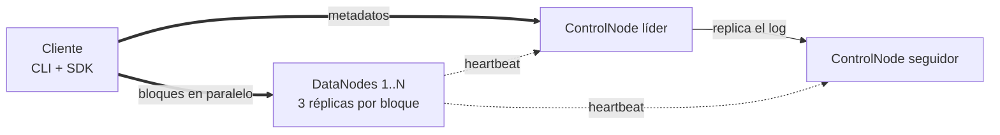

# DFSha: Sistema de Archivos Distribuido por Bloques con Alta Disponibilidad sobre AWS

Proyecto 1 de SI3007 Sistemas Distribuidos (EAFIT, 2026-2). Opción 1: Cliente/Servidor.

DFSha guarda archivos partiéndolos en bloques de 4 MB, reparte los bloques entre varios DataNodes con tres réplicas cada uno y mantiene los metadatos en dos ControlNodes (líder y seguidor). Si se cae un DataNode o el ControlNode líder, el sistema sigue funcionando. Todo viaja por TLS, los bloques se guardan cifrados y cada archivo tiene permisos por usuario y grupo.



El informe técnico completo está en [docs/informe.docx](docs/informe.docx) y la guía para correr cada prueba en [docs/guia_pruebas.docx](docs/guia_pruebas.docx).

## Estructura

```text
src/dfsha/
  client/        CLI (cli.py) y SDK (sdk.py) del cliente
  controlnode/   API de metadatos (main.py), clúster y failover (cluster.py), SQLite (db.py), locks (locks.py)
  datanode/      API de bloques (main.py) y almacenamiento cifrado (storage.py)
  common/        configuración, seguridad, TLS y rutas
scripts/
  generar_seguridad.py   CA, certificados por nodo y .env con secretos
  cluster_local.py       clúster completo como procesos locales (sin Docker)
  generar_archivos.py    archivos de prueba de 1, 10, 50 y 200 MB
  benchmark.py           tiempos de put y get según tamaño y paralelismo
tests/                   pruebas automáticas P1 a P7 (pytest)
load/locustfile.py       prueba de carga P8 y P9 (Locust)
infra/terraform/         VPC, Security Group y EC2 en AWS
docker-compose.yml       clúster local con 2 ControlNodes y 4 DataNodes
docs/                    informe y guía de pruebas
```

## Requisitos

Python 3.11 o superior, Docker con Docker Compose y Terraform 1.5 o superior (solo para AWS).

```bash
python -m venv .venv
# Windows: .venv\Scripts\activate    Linux/Mac: source .venv/bin/activate
pip install -e ".[dev]"
python scripts/generar_seguridad.py
```

El último comando crea `certs/` (CA y un certificado por nodo) y `.env` (secretos y contraseña del admin). Ninguno de los dos se sube a GitHub.

## Opción 1: correr local con Docker Compose

```bash
docker compose up -d --build
dfsha config https://localhost:8001,https://localhost:8002 certs/ca.crt
dfsha login admin                # la contraseña está en .env (ADMIN_PASSWORD)
dfsha useradd ana clave123 equipo
dfsha login ana
dfsha                            # abre el shell interactivo
```

Para simular fallas: `docker stop datanode2` o `docker stop controlnode1`, y luego `docker start ...`.
Para apagar todo: `docker compose down` (con `-v` también borra los datos).

## Opción 2: desplegar en AWS con Terraform

1. Inicie el Learner Lab de AWS Academy y copie las credenciales de "AWS Details" en `~/.aws/credentials`. Vencen cada 4 horas, hay que copiarlas de nuevo en cada sesión.
2. Suba este repositorio a GitHub (las EC2 lo clonan al arrancar) y verifique que sea público.
3. Despliegue:

```bash
python scripts/generar_seguridad.py          # si no lo ha hecho
cd infra/terraform
cp terraform.tfvars.example terraform.tfvars # ponga la contraseña del admin
terraform init
terraform apply
```

4. Espere de 3 a 5 minutos a que las EC2 instalen Docker y arranquen los contenedores. Luego copie el comando que imprime Terraform en `comando_config`:

```bash
dfsha config https://IP_CN1:8000,https://IP_CN2:8000 certs/ca.crt
dfsha login admin
dfsha nodes
```

Para escalar: `terraform apply -var datanode_count=5`. Para borrar todo: `terraform destroy`.
Si algo falla, entre por SSH (`terraform output ssh`) y revise `/var/log/dfsha-setup.log` y `docker logs <nodo>`.

## Uso de la CLI

```text
dfsha:/users/ana> mkdir docs
dfsha:/users/ana> cd docs
dfsha:/users/ana/docs> put pruebas/video_50mb.bin
Subiendo pruebas/video_50mb.bin (50.0 MB) a /users/ana/docs/video_50mb.bin ...
OK: 13 bloques, 2.9 s (17.2 MB/s)
dfsha:/users/ana/docs> info video_50mb.bin
/users/ana/docs/video_50mb.bin  50.0 MB  versión 1  13 bloques de hasta 4.0 MB
  bloque 0    270450b3c858     4.0 MB  -> datanode1, datanode2, datanode3
  bloque 1    d5977f3ff44f     4.0 MB  -> datanode2, datanode3, datanode4
  ...
dfsha:/users/ana/docs> get video_50mb.bin descargas/
dfsha:/users/ana/docs> cat notas.txt 0 100      # lee solo los primeros 100 bytes
dfsha:/users/ana/docs> lock notas.txt w 60
dfsha:/users/ana/docs> chgrp equipo notas.txt
dfsha:/users/ana/docs> nodes
```

`help` muestra todos los comandos. También se puede ejecutar un solo comando sin entrar al shell, por ejemplo `dfsha ls /users/ana`.

## Uso del SDK

```python
from dfsha.client import DFSClient

c = DFSClient(["https://IP_CN1:8000", "https://IP_CN2:8000"], ca_file="certs/ca.crt")
c.login("ana", "clave123")
c.put("foto.jpg", "/users/ana/foto.jpg")
c.get("/users/ana/foto.jpg", "copia.jpg")
with c.open("/users/ana/notas.txt", "r") as f:
    print(f.pread(0, 100))
with c.open("/users/ana/nuevo.txt", "w") as f:
    f.write("hola")
```

## Pruebas

```bash
pytest -v                                   # P1 a P7: levanta un clúster local y prueba todo (1 min aprox.)
python scripts/generar_archivos.py          # archivos de prueba en pruebas/
locust -f load/locustfile.py                # P8: interfaz en http://localhost:8089
python scripts/benchmark.py --clave XXXX    # P10: tiempos de put y get
```

El detalle de cada prueba, qué capturar y dónde va en el informe está en [docs/guia_pruebas.docx](docs/guia_pruebas.docx).

## Configuración

Cada nodo se configura con variables de entorno. Las más importantes:

| Variable | Valor por defecto | Para qué |
|---|---|---|
| `BLOCK_SIZE` | 4194304 (4 MB) | Tamaño de bloque |
| `REPLICATION_FACTOR` | 3 | Copias por bloque |
| `MIN_REPLICAS` | 2 | Copias confirmadas para aceptar una escritura |
| `HEARTBEAT_INTERVAL` | 3 s | Cada cuánto el DataNode reporta |
| `DN_DEAD_AFTER` | 10 s | Sin heartbeat por este tiempo, el DataNode se da por caído |
| `ROLE_INTERVAL` y `FAILOVER_MISSES` | 2 s y 3 | Chequeo entre ControlNodes y fallos seguidos para tomar el liderazgo |
| `MONITOR_INTERVAL` | 5 s | Cada cuánto el líder revisa réplicas faltantes |
